# 🛠️ Jenkins DevOps Lab: Step-by-Step Practical Guide

**Target Jenkins Server:** [http://localhost:8000](http://localhost:8000)  
**Jenkins Version:** 2.580.1  
**Default Credentials:** User: `sai`

---

## 📑 Table of Contents
1. [Lab 1: Your First Jenkins Job (Freestyle Project)](#lab-1-your-first-jenkins-job-freestyle-project)
   - [Step 0: Accessing Jenkins & Sign In](#step-0-accessing-jenkins--sign-in)
   - [Step 1: Dashboard -> New Item](#step-1-dashboard---new-item)
   - [Step 2: Enter Item Name & Select Freestyle Project](#step-2-enter-item-name--select-freestyle-project)
   - [Step 3 & 4: Adding OS Build Step](#step-3--4-adding-os-build-step)
   - [Step 5: Paste Command Script & Save](#step-5-paste-command-script--save)
   - [Step 6: Triggering Build with 'Build Now'](#step-6-triggering-build-with-build-now)
   - [Step 7: Build History & Status Indicators](#step-7-build-history--status-indicators)
   - [Step 8: Console Output Verification](#step-8-console-output-verification)
   - [🎓 Instructor Teaching Moment: Exit Code Mechanics](#-instructor-teaching-moment-exit-code-mechanics)
2. [Lab 2: Parameterized Builds (Dynamic Inputs)](#lab-2-parameterized-builds-dynamic-inputs)
   - [Step 1: Create '02-parameterized-job'](#step-1-create-02-parameterized-job)
   - [Step 2: Enable 'This project is parameterized'](#step-2-enable-this-project-is-parameterized)
   - [Step 3: Add Choice Parameter (DEPLOY_ENV)](#step-3-add-choice-parameter-deploy_env)
   - [Step 4: Add String Parameter (APP_VERSION)](#step-4-add-string-parameter-app_version)
   - [Step 5 & 6: Parameterized Build Step Command & Save](#step-5--6-parameterized-build-step-command--save)
   - [Step 7: Trigger 'Build with Parameters'](#step-7-trigger-build-with-parameters)
   - [Step 8: Console Output Verification](#step-8-console-output-verification-1)
   - [🎓 Instructor Teaching Moment: Environment Variable Mechanics](#-instructor-teaching-moment-environment-variable-mechanics)
3. [Interactive Web Guide (HTML)](#interactive-web-guide-html)

---

# Lab 1: Your First Jenkins Job (Freestyle Project)

### 🎯 Objective
Teach students how Jenkins triggers automated tasks, runs native OS shell/batch commands, and captures standard output (`stdout`) and standard error (`stderr`) in the **Console Output**.

---

### Step 0: Accessing Jenkins & Sign In
Open your web browser and navigate to **[http://localhost:8000](http://localhost:8000)**. Enter your username and password, then click **Sign in**.

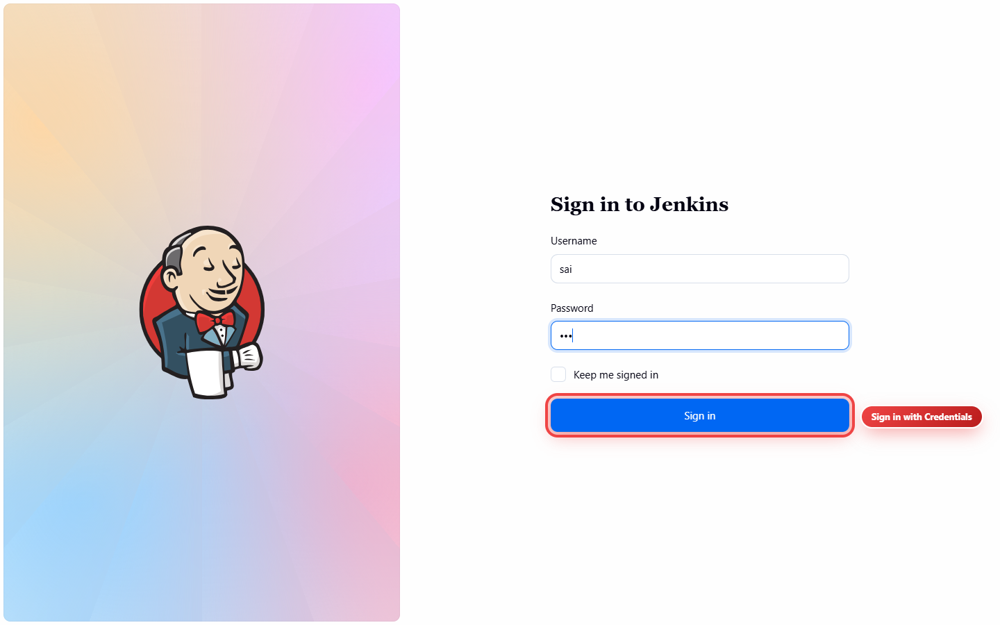

---

### Step 1: Dashboard -> New Item
From the Jenkins main dashboard, navigate to the top-left sidebar navigation menu and click **New Item**.

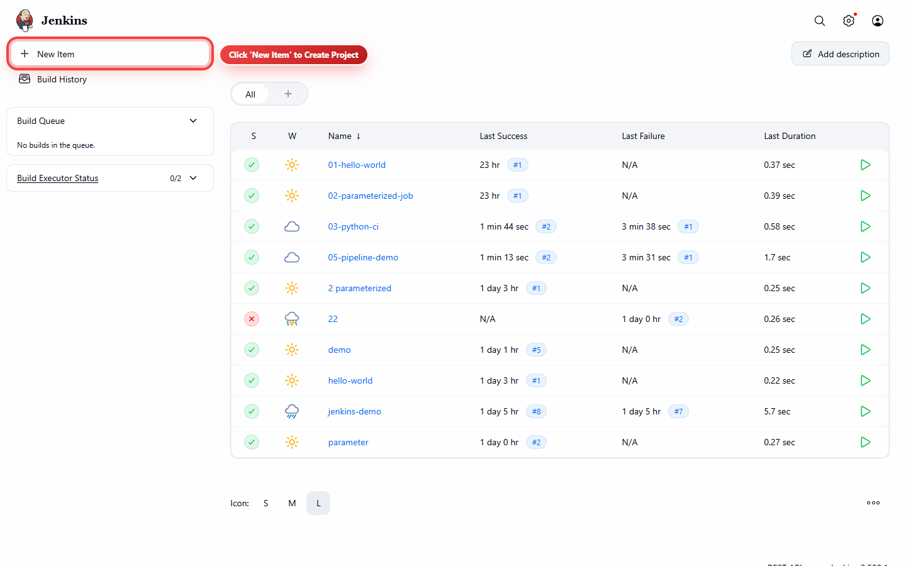

> **Visual Cue:** Look for the highlighted red callout pointing directly to **New Item** on the left menu.

---

### Step 2: Enter Item Name & Select Freestyle Project
1. In the **Enter an item name** field, type: `01-hello-world`
2. Select **Freestyle project** from the card list.
3. Scroll down and click **OK**.

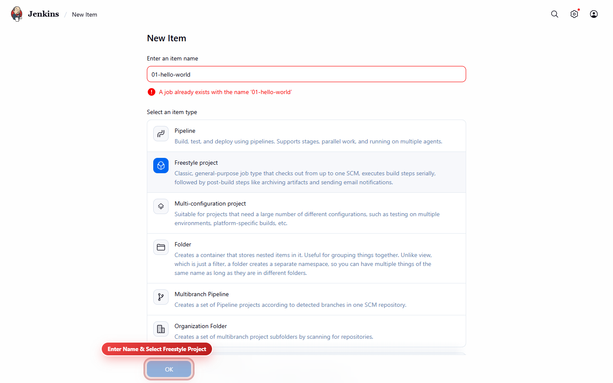

---

### Step 3 & 4: Adding OS Build Step
1. In the project configuration page, scroll down to the **Build Steps** section.
2. Click the **Add build step** dropdown button.

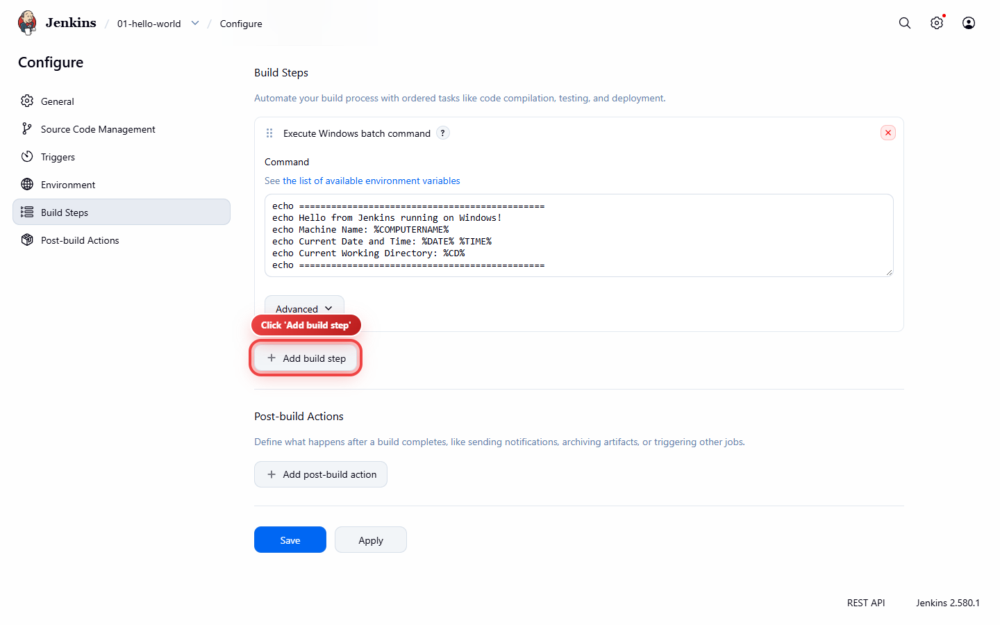

3. Select the appropriate command runner for your operating system:
   - **Windows Students:** Select **Execute Windows batch command**
   - **Linux / Mac Students:** Select **Execute shell**

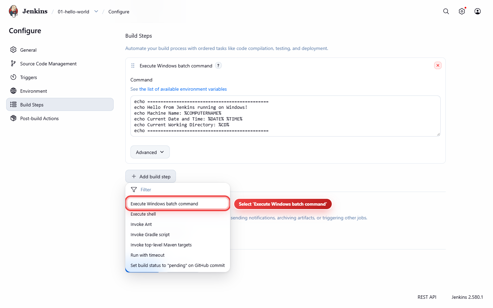

---

### Step 5: Paste Command Script & Save
Paste the appropriate command script into the **Command** text area:

#### 🪟 Windows Students (Execute Windows batch command):
```bat
echo ==============================================
echo Hello from Jenkins running on Windows!
echo Machine Name: %COMPUTERNAME%
echo Current Date and Time: %DATE% %TIME%
echo Current Working Directory: %CD%
echo ==============================================
```

#### 🐧 Linux / macOS Students (Execute shell):
```bash
echo "=============================================="
echo "Hello from Jenkins running on Linux!"
echo "Hostname: $(hostname)"
echo "Current Date: $(date)"
echo "Running as User: $(whoami)"
echo "Current Working Directory: $(pwd)"
echo "=============================================="
```

Click the **Save** button at the bottom of the page.

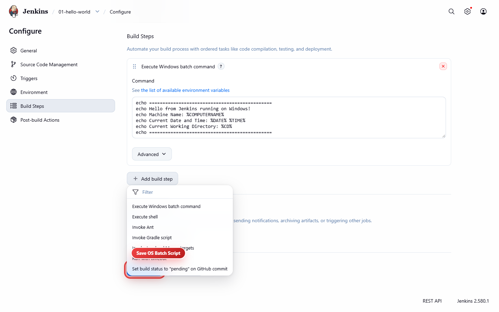

---

### Step 6: Triggering Build with 'Build Now'
You will be redirected to the project page for `01-hello-world`. In the left sidebar menu, click **Build Now**.

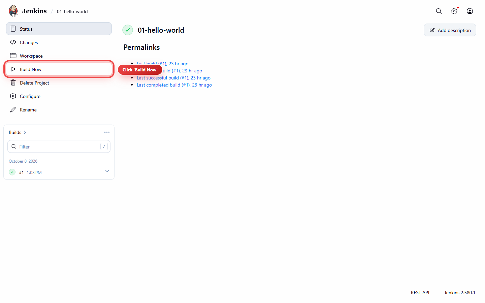

---

### Step 7: Build History & Status Indicators
Look at the **Build History** widget on the lower-left sidebar. A new build item **#1** will appear with a solid blue status ball (indicating SUCCESS).

Click on **#1** to view the build details.

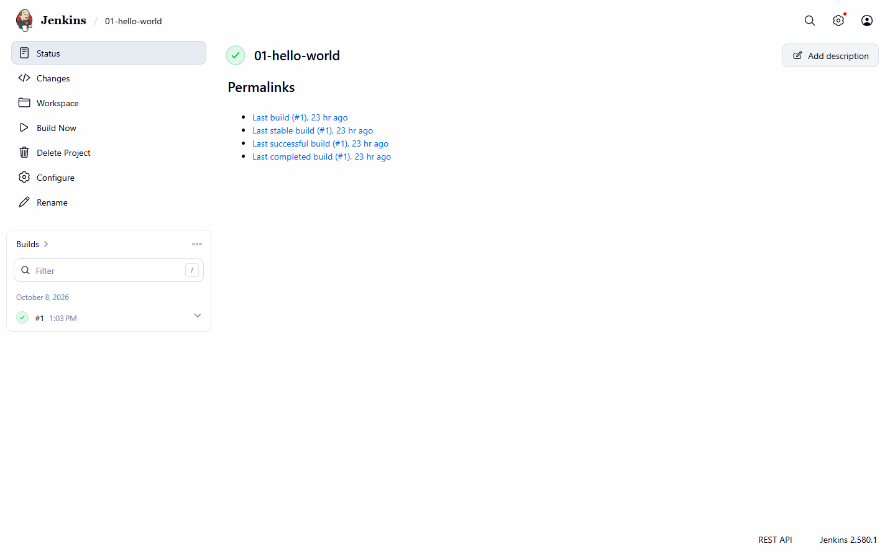

---

### Step 8: Console Output Verification
In the left sidebar menu under build #1, click **Console Output**.

Review the output to see your machine name, date/time, and working directory printed. The build terminates with `Finished: SUCCESS`.

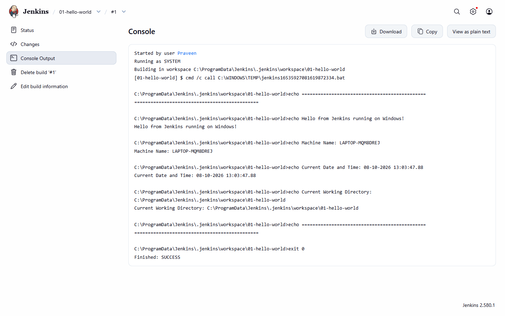

---

### 🎓 Instructor Teaching Moment: Exit Code Mechanics

> [!IMPORTANT]
> **Direct student attention to the last line:** `Finished: SUCCESS`.  
> Explain that Jenkins does **not** interpret text output; rather, **Jenkins strictly monitors the operating system exit code**:
> - **Exit Code `0`:** Jenkins marks the build as **SUCCESS (Blue / Green Ball)**.
> - **Any Non-Zero Exit Code (e.g., `1`, `127`):** Jenkins halts execution and marks the build as **FAILURE (Red Ball)**.
>
> In batch files, this corresponds to `errorlevel`. In Linux shells, this is stored in `$?`.

---

# Lab 2: Parameterized Builds (Dynamic Inputs)

### 🎯 Objective
Show how real-world CI/CD pipelines accept runtime parameters (such as target environment, release version, or Git branch) and inject them into build steps as operating system environment variables.

---

### Step 1: Create '02-parameterized-job'
1. From the Jenkins dashboard, click **New Item**.
2. Enter item name: `02-parameterized-job`.
3. Select **Freestyle project** and click **OK**.

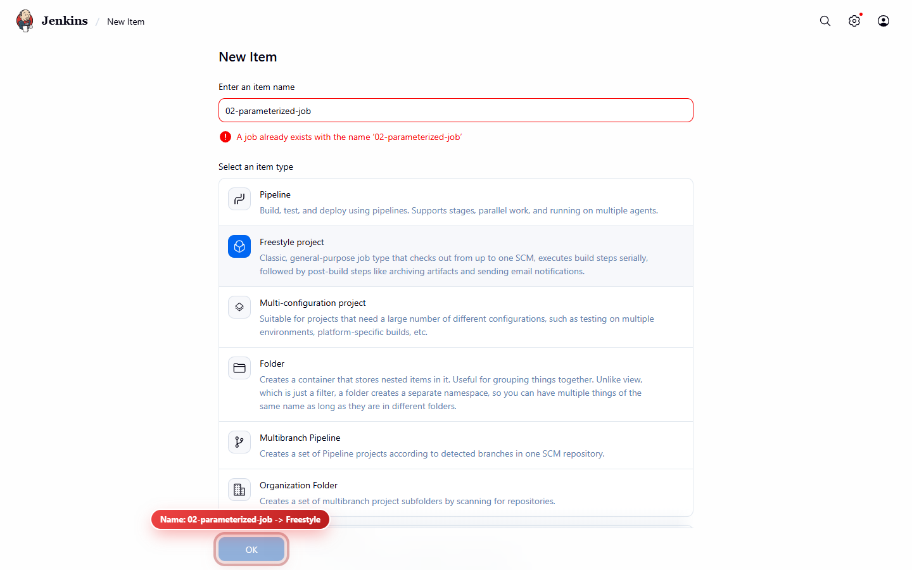

---

### Step 2: Enable 'This project is parameterized'
In the **General** configuration tab, check the box labeled **This project is parameterized**.

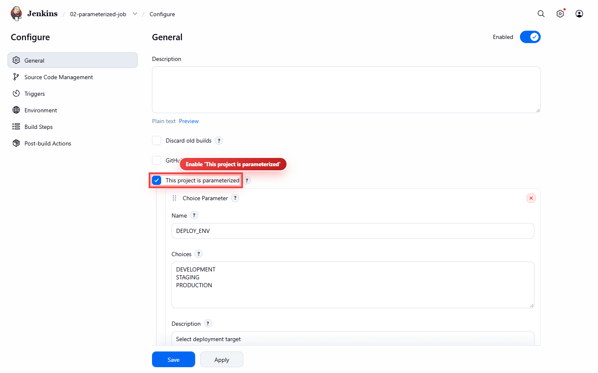

---

### Step 3: Add Choice Parameter (`DEPLOY_ENV`)
1. Click the newly revealed **Add Parameter** dropdown button and select **Choice Parameter**.

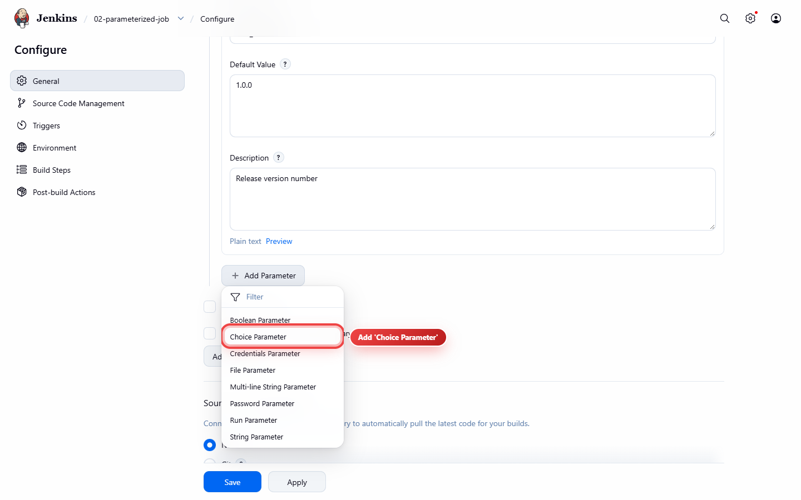

2. Configure the Choice Parameter fields:
   - **Name:** `DEPLOY_ENV`
   - **Choices (one per line):**
     ```text
     DEVELOPMENT
     STAGING
     PRODUCTION
     ```
   - **Description:** `Select deployment target`

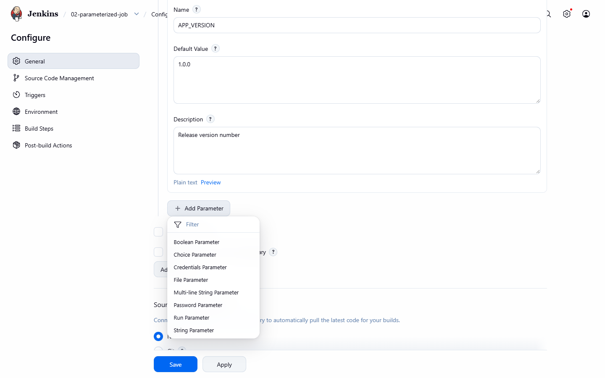

---

### Step 4: Add String Parameter (`APP_VERSION`)
1. Click **Add Parameter** again and select **String Parameter**.

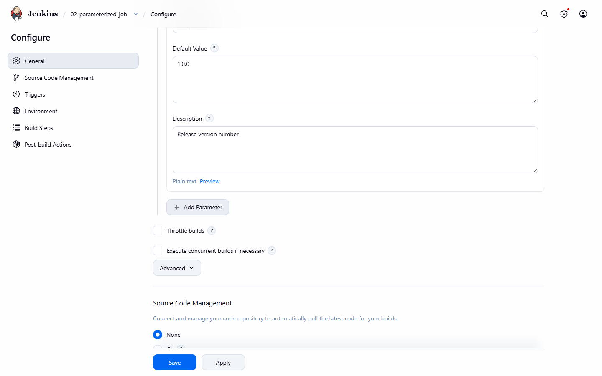

2. Configure the String Parameter fields:
   - **Name:** `APP_VERSION`
   - **Default Value:** `1.0.0`
   - **Description:** `Release version number`


---

### Step 5 & 6: Parameterized Build Step Command & Save
1. Scroll down to the **Build Steps** section.
2. Click **Add build step** and choose your OS command runner.
3. Enter the parameterized script:

#### 🪟 Windows Batch Command:
```bat
echo Deploying Version %APP_VERSION% to %DEPLOY_ENV% Environment...
```

#### 🐧 Linux Shell Command:
```bash
echo "Deploying Version ${APP_VERSION} to ${DEPLOY_ENV} Environment..."
```

4. Click **Save** at the bottom of the page.

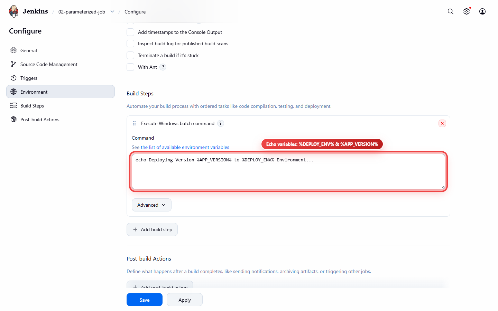

---

### Step 7: Trigger 'Build with Parameters'
1. Notice that the sidebar button now says **Build with Parameters** instead of *Build Now*! Click it.

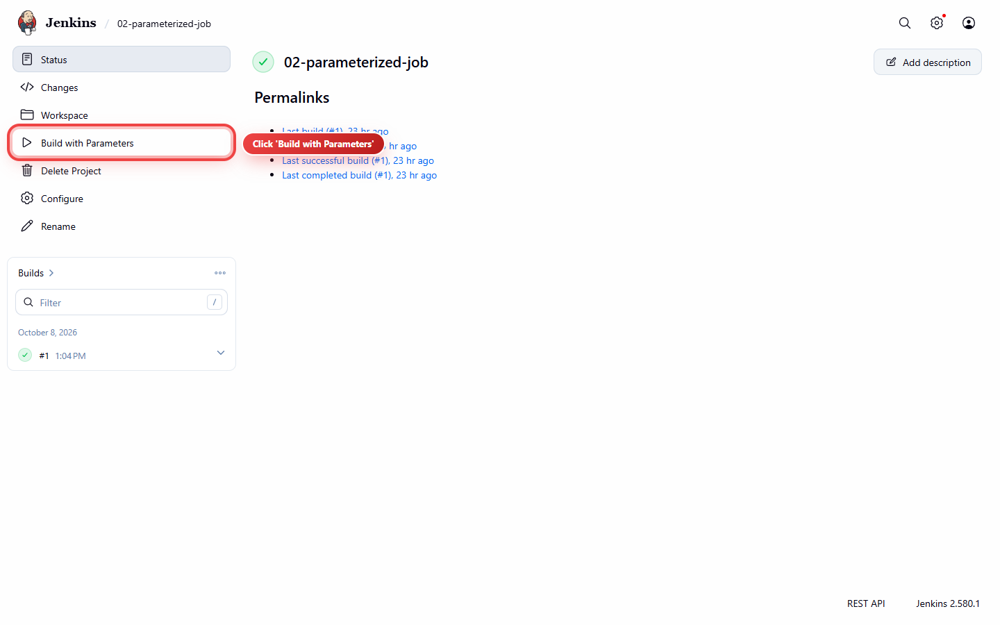

2. On the interactive build parameters page:
   - Pick **DEPLOY_ENV:** `STAGING`
   - Enter **APP_VERSION:** `v2.0.0`
3. Click the blue **Build** button.

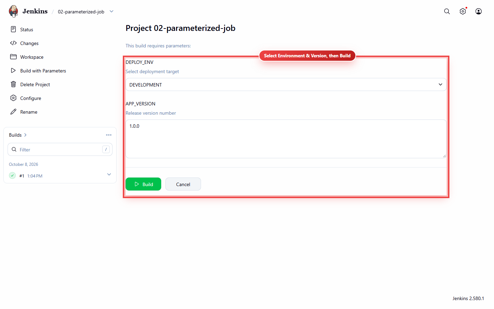

---

### Step 8: Console Output Verification
1. Open Build History **#1** and select **Console Output**.
2. Verify that Jenkins dynamically injected the runtime inputs:
   ```text
   Deploying Version v2.0.0 to STAGING Environment...
   ```
3. Verify that the build completed with `Finished: SUCCESS`.

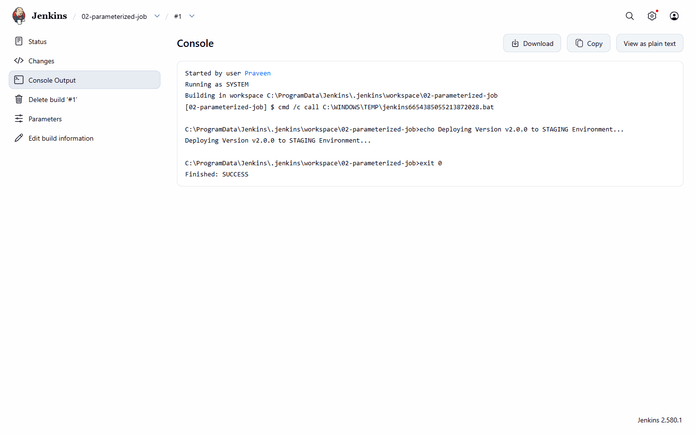

---

### 🎓 Instructor Teaching Moment: Environment Variable Mechanics

> [!TIP]
> **Key Architecture Insight for Students:**  
> When a build is triggered, Jenkins exports every defined parameter into the process execution environment:
> - **Windows:** Variables are referenced using `%VAR_NAME%`.
> - **Linux / POSIX:** Variables are referenced using `${VAR_NAME}` or `$VAR_NAME`.
> - **Pipeline (Jenkinsfile):** Accessed via `params.VAR_NAME` or `env.VAR_NAME`.
>
> In production environments, parameter input validation and sanitization are essential to prevent command injection risks.

---

## 🌐 Interactive Web Guide (HTML)
An interactive HTML version with dark/light mode toggle, OS code copy buttons, and zoomable screenshots is available in this directory:
- Open [`index.html`](index.html) in your browser.
